# TCPDump_Project — Build a Network Logging Tool


A personal cybersecurity project that builds a **network logging tool** on top of
**`tcpdump`** — capturing, filtering, rotating and decrypting network traffic — run
inside a **Debian / Kali Linux VM** on **Oracle VirtualBox**.

The repository contains the coursework task scripts (kept as evidence), a unified
logging CLI, documentation, tests, CI linting and a screenshot walkthrough as visual proof.

---

## What is tcpdump?

`tcpdump` is a command-line packet capture utility for Unix-like systems (Linux / BSD / macOS).
It requires superuser privileges and captures raw network packets. It supports:

- capturing on any interface — `-i <iface>`
- filtering by protocol, host, port, source and destination — `host`, `src`, `dst`, `port`
- writing captures to a file — `-w file.pcap`, and reading them back — `-r file.pcap`
- rotating capture files by time and size — `-G <seconds>`, `-C <megabytes>`
- different display formats — `-A` (ASCII), `-XX` (hex), `-#` (line numbers), `-tttt` (timestamps)

> `tcpdump` does **not** decrypt encrypted traffic by itself. Decryption is done in
> Wireshark using TLS keys exported by the browser through `SSLKEYLOGFILE`.

## What this project does

The project implements the objectives of the *"Analyze Network Traffic with TCPDump:
Build a Logging Tool"* coursework:

1. **Getting started** — capture traffic with `sudo tcpdump`; superuser is required and
   encrypted payloads are not readable natively.
2. **Shell script + targeting** — build the logging script; list interfaces (`-D`),
   isolate one interface (`-i`), limit capture by host / IP / source / destination / port.
3. **Save and read** — write captures with `-w`, read them with `-r`, analyse with Wireshark.
4. **Sequential dumps** — rotate files by time (`-G`) and size (`-C`).
5. **SSL keys + Wireshark** — export `SSLKEYLOGFILE` and point Wireshark at the
   TLS pre-master-secret log to decode encrypted traffic.

## Features

- **Unified logging CLI** — `src/logger.sh` wraps tcpdump: interface, filter, output,
  packet count, time/size rotation and TLS key logging in one command.
- **Task scripts** — the original course scripts, cleaned up and linted.
- **Safe by default** — capture files and key logs are ignored by git.
- **Documented** — architecture and usage guides in `docs/`.
- **Tested** — `tests/test_scripts.sh` checks shebangs and bash syntax; CI runs shellcheck.
- **Extensible** — structure designed for filter presets, TUI and a web dashboard.

## Repository structure

```text
TCPDump_Project/
├── README.md
├── LICENSE                       # MIT
├── CONTRIBUTING.md
├── ROADMAP.md
├── .gitattributes                # enforces LF for scripts
├── .gitignore                    # never commit pcaps / key logs
├── .github/workflows/
│   └── shellcheck.yml            # CI: lint + script tests
├── src/
│   └── logger.sh                 # unified logging CLI (main tool)
├── scripts/
│   ├── checkspy.sh               # SSH capture (port 22)
│   ├── key_extraction.sh         # SSL keys + capture to a host
│   └── watchdog.sh               # short packet-count capture
├── config/
│   └── logger.conf.example       # example configuration
├── tests/
│   └── test_scripts.sh           # shebang + syntax checks
├── docs/
│   ├── ARCHITECTURE.md
│   ├── USAGE.md
│   ├── TCP Dump_Tasks breakdown.pdf
│   └── TCPDump Quick Reference.pdf
└── screenshots/                  # walkthrough images (see screenshots/README.md)
```

## Quick start

```bash
git clone https://github.com/Mi117/TCPDump_Project.git
cd TCPDump_Project

sudo apt update && sudo apt install -y tcpdump   # capture engine
chmod +x src/logger.sh scripts/*.sh tests/*.sh

./src/logger.sh --help
```

### Unified logging tool

```bash
# Capture everything -> capture.pcap (rotate every 600 s / 2 MB)
./src/logger.sh

# SSH traffic only
./src/logger.sh -f "port 22" -o proof.pcap

# HTTPS on a specific interface
./src/logger.sh -i eth0 -f "port 443" -o https.pcap

# Watchdog: 10 packets to one host, rotate 15 s / 1 MB
./src/logger.sh -c 10 -f "host 10.0.2.15" -t 15 -s 1 -o capture.pcap

# TLS key logging for Wireshark decryption
./src/logger.sh -k /home/kali/tcpdump_project/sslkeys.log -f "host example.com"

# List available interfaces
./src/logger.sh -D
```

| Flag | Meaning |
|---|---|
| `-i, --interface IFACE` | interface to capture on (default `any`) |
| `-f, --filter EXPR` | tcpdump/BPF filter expression |
| `-o, --output FILE` | output pcap (default `capture.pcap`) |
| `-t, --rotate-time SEC` | rotate every `SEC` seconds (`0` = off) |
| `-s, --rotate-size MB` | rotate after `MB` megabytes (`0` = off) |
| `-c, --count N` | stop after `N` packets (`0` = unlimited) |
| `-k, --ssl-keys PATH` | export `SSLKEYLOGFILE=PATH` |
| `-D, --list-interfaces` | list interfaces and exit |
| `-h, --help` | show help |

### Task scripts

```bash
sudo ./scripts/checkspy.sh        # SSH capture            -> proof.pcap
sudo ./scripts/key_extraction.sh  # SSL keys + NASA host   -> capture.pcap
sudo ./scripts/watchdog.sh        # 10 packets to a host   -> capture.pcap
```

### Running the checks

```bash
bash tests/test_scripts.sh        # shebangs + bash -n (+ shellcheck if installed)
```

---

## Walkthrough — visual proof

Every step below is documented with a screenshot from the lab VM.
A short index of all images is in [`screenshots/README.md`](screenshots/README.md).

### Environment

Debian/Kali Linux running inside Oracle VirtualBox — the environment used for every capture.

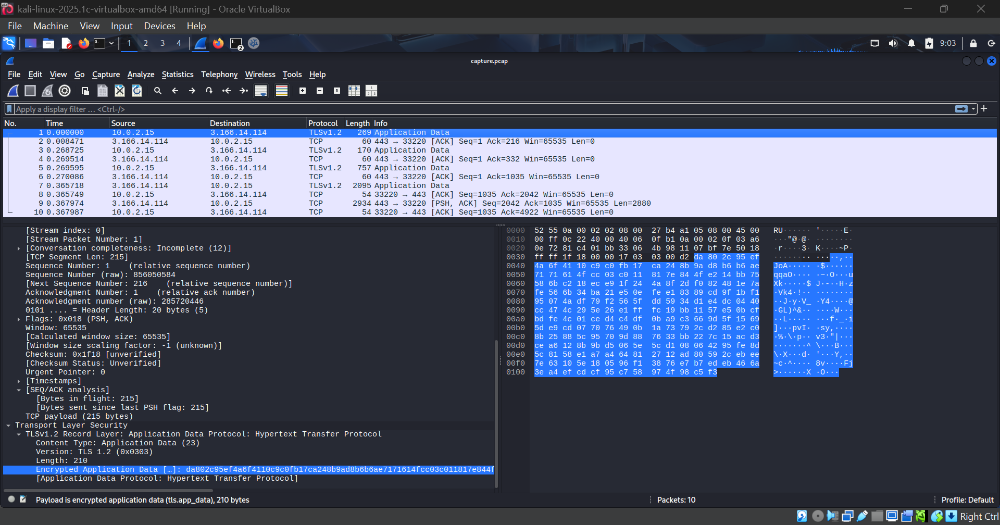

### Task 1 — Basic commands

The starting point: capturing live traffic with `tcpdump` and reading the verbose output
(timestamps, ARP/DNS/TCP summaries, flags and sequence numbers).

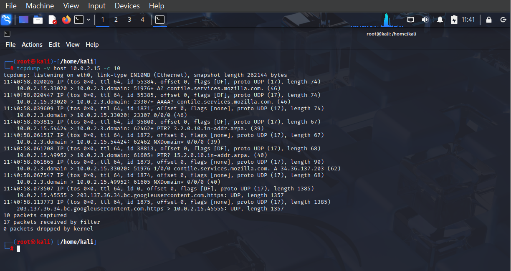

Adding detail to the output — protocol decoding, lengths and packet structure.

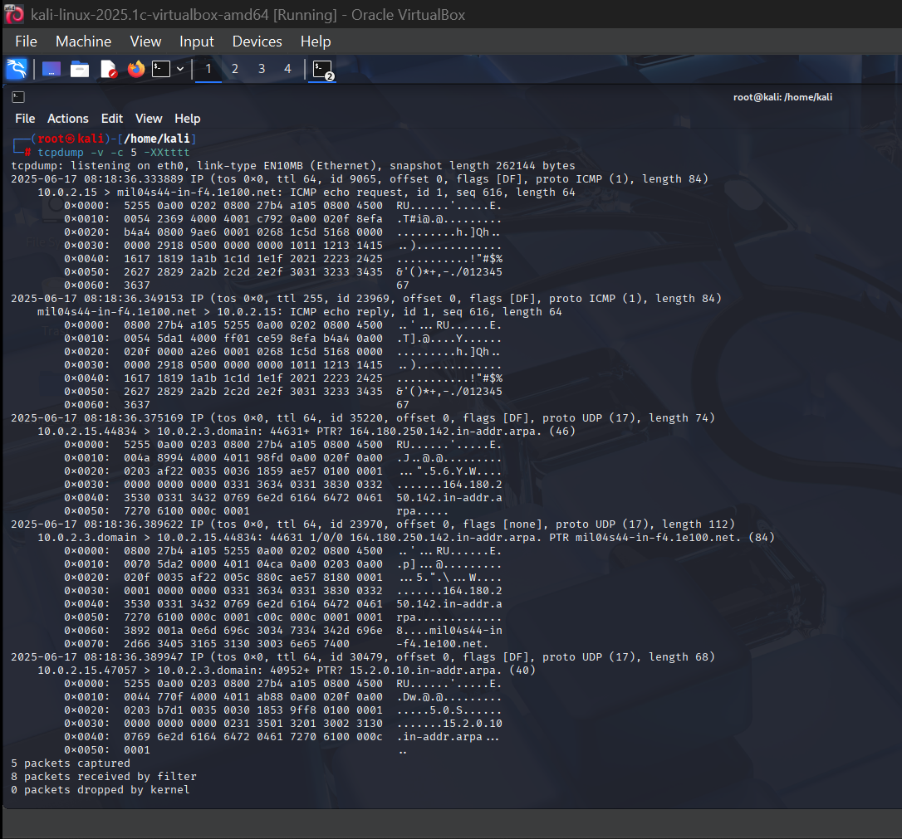

### Task 2 — Shell script and targeting

**List the interfaces** available to the capture engine:

```bash
sudo tcpdump -D
```

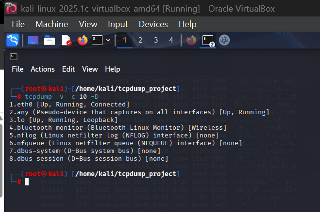

Output of `-D`: `eth0` (connected), `any` (pseudo-device for all interfaces), `lo` (loopback),
plus bluetooth / netfilter / D-Bus interfaces.

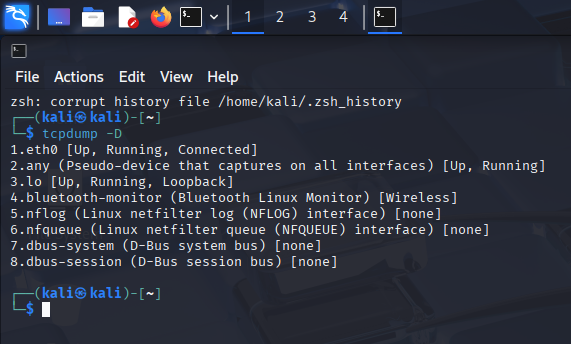

**Isolate one interface** with `-i`:

```bash
sudo tcpdump -i eth0
```

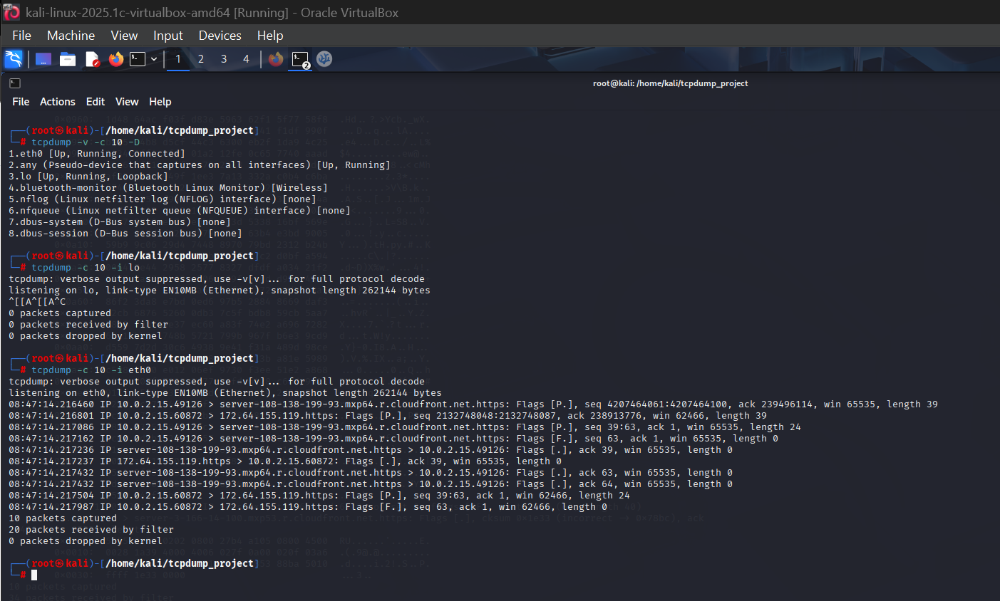

Capturing only on `eth0` — DNS queries, ARP replies and the first TLS handshake packets
are visible while other interfaces are ignored.

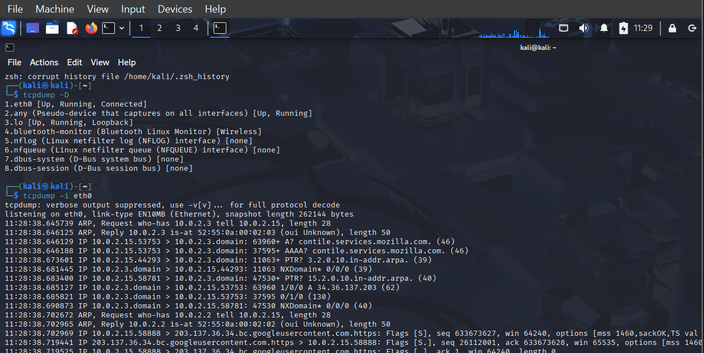

**Target the traffic** with host / source / destination / port filters:

```bash
sudo tcpdump host <host>
sudo tcpdump src <ip> / dst <ip> / port <n>
```

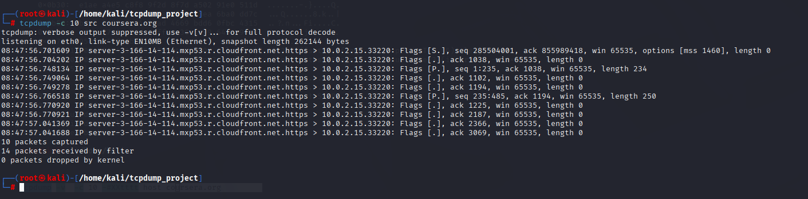

**Build the logging scripts** in `~/tcpdump_project` and make them executable:

```bash
ls -al
chmod 777 watchdog.sh
```

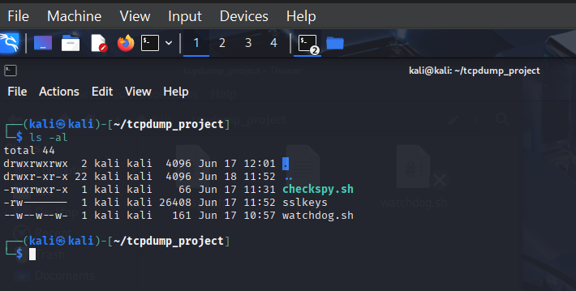

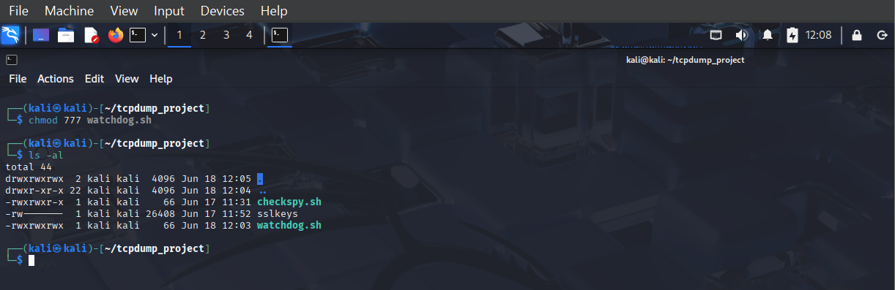

The script itself (`watchdog.sh`) in VS Code — a shebang line plus a single `tcpdump`
command with packet count, size and time limits:

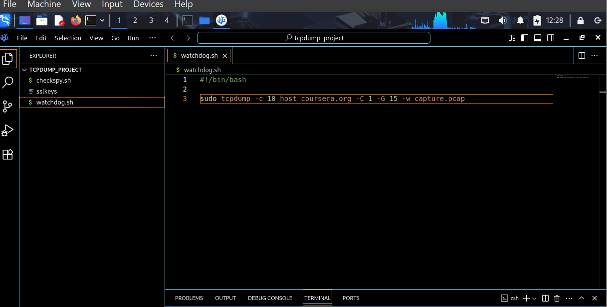

### Task 3 — Save and read captures

**Write the capture to a file:**

```bash
sudo tcpdump -w capture.pcap
```

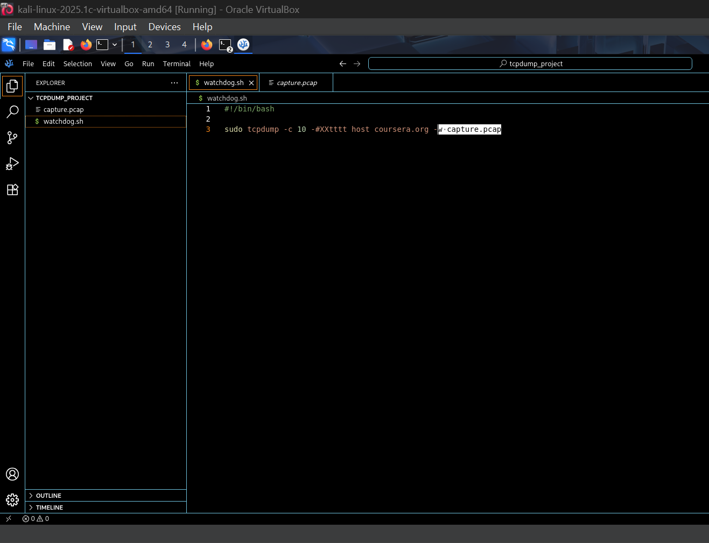

**Read it back** with `tcpdump -r` — or notice that opening a `.pcap` in a text editor
shows only binary data:

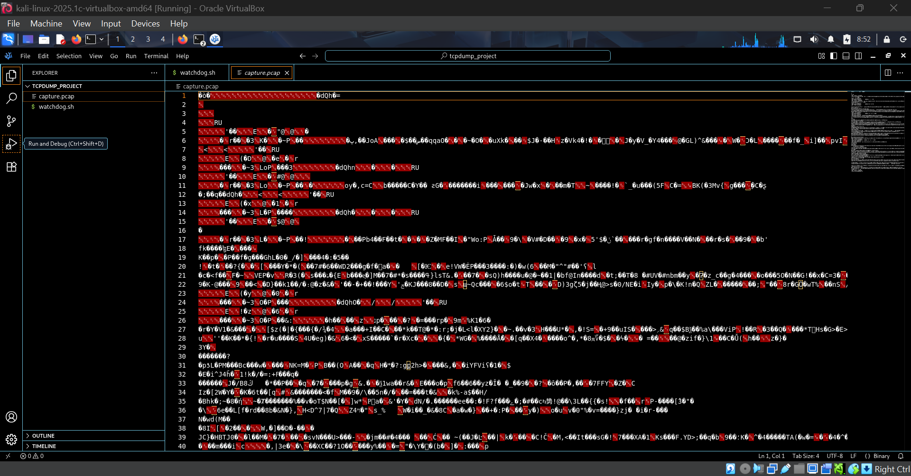

That is why the capture is analysed in **Wireshark**, which decodes each layer and shows
the application data (still encrypted at this stage):

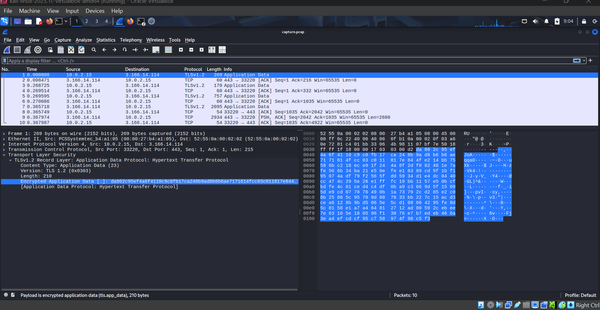

### Task 4 — Sequential dumps (rotation)

**Limit file size** so a long capture cannot fill the disk — here 1 MB per file:

```bash
sudo tcpdump -w capture.pcap -C 1
```

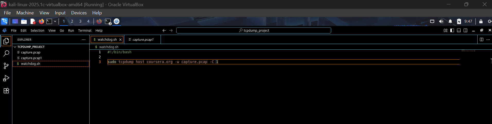

**Rotate by time and size** (`-G` seconds, `-C` megabytes), producing multiple numbered
capture files instead of one large dump:

```bash
sudo tcpdump -w capture.pcap -G 600 -C 1
```

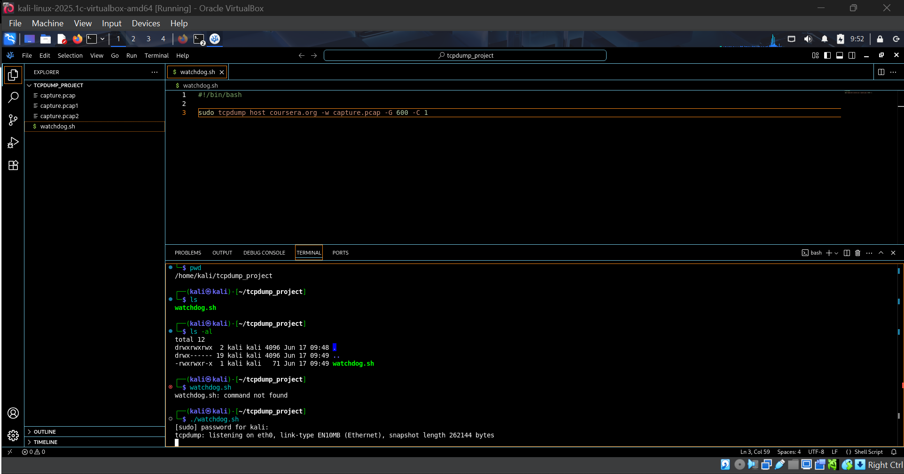

### Task 5 — SSL keys and Wireshark decryption

**Export the TLS keys** from the browser and capture the target host:

```bash
export SSLKEYLOGFILE=/home/kali/tcpdump_project/sslkeys.log
/usr/bin/google-chrome-stable &
sudo tcpdump host apd.nasa.gov -w capture.pcap -G 600 -C 1
```

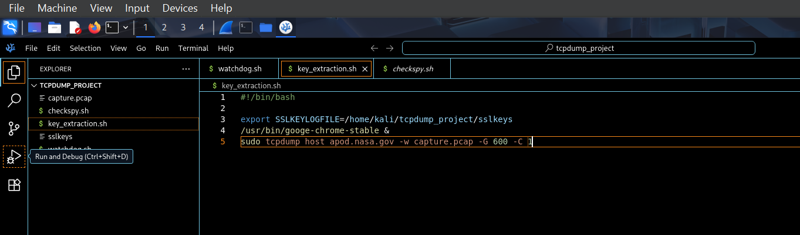

**Configure Wireshark** — open *Edit → Preferences*:

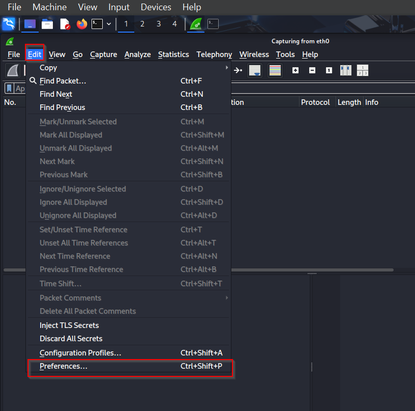

…then select **Protocols → TLS** and set the *Pre-Master-Secret log filename* to the
key log created above:

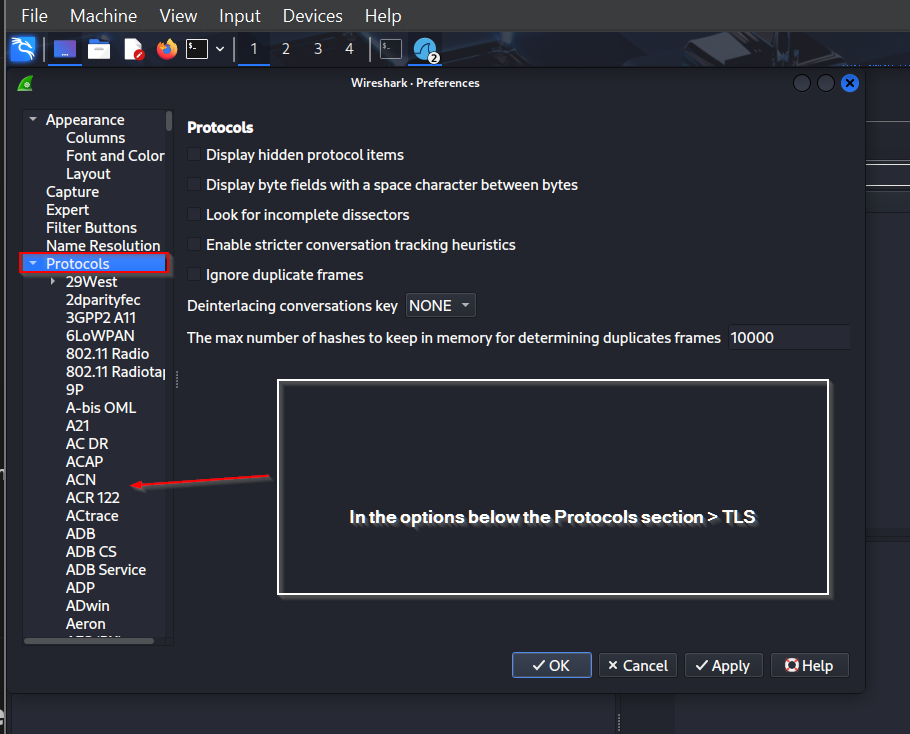

**Result** — the captured traffic to `apd.nasa.gov` decoded in Wireshark (TLS 1.2
Client Hello / Server Hello, cipher suites, handshake messages with the SNI visible):

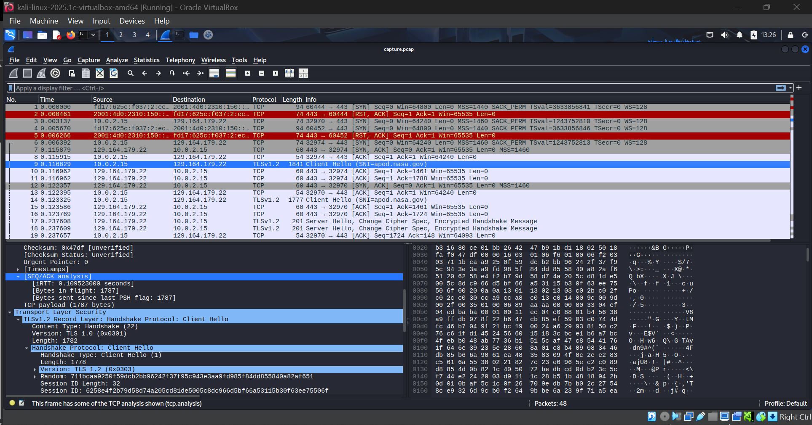

---

## Documentation

- [`docs/USAGE.md`](docs/USAGE.md) — detailed usage guide and Wireshark setup
- [`docs/ARCHITECTURE.md`](docs/ARCHITECTURE.md) — repository design and extension points
- [`ROADMAP.md`](ROADMAP.md) — planned features
- [`CONTRIBUTING.md`](CONTRIBUTING.md) — contribution workflow
- [`screenshots/README.md`](screenshots/README.md) — index of all walkthrough images

## Roadmap

- [ ] Filter presets (SSH, HTTP/HTTPS, DNS)
- [ ] Live capture statistics / summary reports
- [ ] Interactive CLI (TUI)
- [ ] Web dashboard to manage captures
- [ ] Installer / packaging script

## Notes and safety

- Capture files (`*.pcap`) and key logs (`sslkeys.log`) are ignored by git — they can
  contain sensitive data. Never commit them.
- Capturing traffic requires `sudo`; run the tool only on networks you own or are
  authorised to monitor.
- The `-G` / `-C` rotation options only apply together with `-w` (the logger always sets it).

## License

MIT — see [`LICENSE`](LICENSE). © 2026 Michele Filandro (Mi117)

---

*Created as part of a cybersecurity degree path project: building a network logging tool with tcpdump.*
